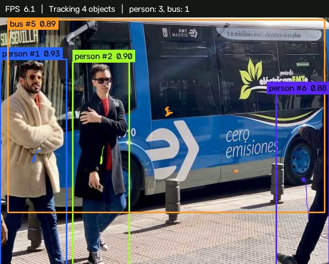
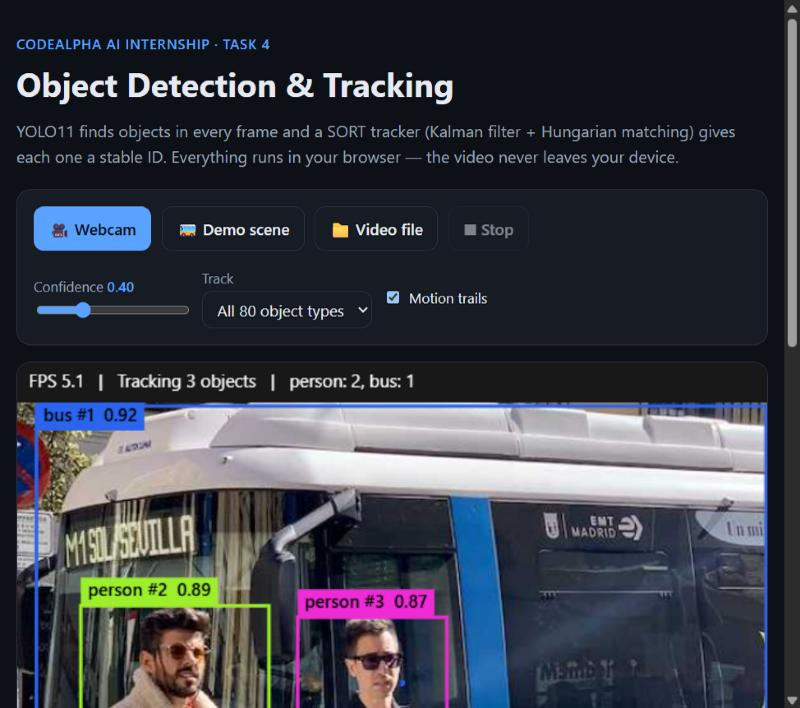

# Object Detection and Tracking

**CodeAlpha AI Internship — Task 4**

🌐 **Live demo:** https://codealpha-object-tracking-sayan.netlify.app — runs on your webcam (or a demo scene / video file) right in the browser.

Real-time object detection and multi-object tracking on a webcam or video file. Every frame is passed through a pre-trained **YOLO** model to detect objects, and a **SORT** tracker (Kalman filter + Hungarian algorithm, implemented from scratch in `sort_tracker.py`) gives every object a stable ID while it moves across the frame.



## Features

- Live input from a **webcam** or any **video file** (OpenCV)
- Detection with **YOLO11** pre-trained on COCO (80 classes: person, car, dog, phone, bottle, ...)
- **SORT** tracking: each object keeps the same ID across frames
- Bounding boxes, class labels, confidence scores and **track IDs** drawn in a unique colour per object
- **Motion trails** showing the recent path of every tracked object
- On-screen panel with FPS and a live count of each object class
- Filter to specific classes (`--classes person car`)
- Save the annotated result as an `.mp4` (`--save`)

## How it works

```
 Webcam / video ──▶ OpenCV reads a frame
                         │
                         ▼
                  YOLO11 detector ──▶ boxes [x1, y1, x2, y2, confidence, class]
                         │
                         ▼
                  SORT tracker
                   1. Kalman filter predicts where every known object moved
                   2. IoU matrix between predictions and new detections
                   3. Hungarian algorithm assigns detections to tracks
                   4. matched tracks are updated, new objects get new IDs,
                      objects missing for too long are removed
                         │
                         ▼
            draw boxes + "person #3 0.91" + trails + FPS ──▶ window / output.mp4
```

**Why tracking?** A detector only says *"there is a person here"* in each frame independently. The tracker links those detections over time, so the program knows it is the *same* person — which is what you need for counting, following or analysing movement.

The SORT state for every object is `[cx, cy, area, aspect_ratio, vx, vy, v_area]` — the box centre, size and their velocities — with a constant-velocity motion model, as in the original paper (*Bewley et al., "Simple Online and Realtime Tracking", 2016*).

## Run it

```bash
git clone https://github.com/sayan30082000/CodeAlpha_ObjectDetection.git
cd CodeAlpha_ObjectDetection
python -m venv venv
venv\Scripts\activate          # macOS/Linux: source venv/bin/activate
pip install -r requirements.txt
```

The YOLO weights (`yolo11n.pt`, ~5 MB) download automatically the first time.

```bash
# webcam
python detect_track.py

# a video file
python detect_track.py --source path/to/video.mp4

# only people and cars, save the output, no window
python detect_track.py --source traffic.mp4 --classes person car --save output.mp4 --no-show

# no webcam? make a short test video from the sample image bundled with ultralytics
python make_sample_video.py
python detect_track.py --source sample_video.mp4
```

Keys while running: **q** or **Esc** = quit, **p** = pause.

### Options

| Option | Default | Meaning |
|---|---|---|
| `--source` | `0` | webcam index or video path |
| `--model` | `yolo11n.pt` | YOLO weights (`yolo11s.pt` is more accurate, slower) |
| `--conf` | `0.4` | minimum detection confidence |
| `--imgsz` | `640` | inference size; use `480` or `320` for more FPS on a CPU |
| `--classes` | all | class names to keep, e.g. `person car dog` |
| `--max-age` | `15` | frames a lost object keeps its ID |
| `--min-hits` | `3` | detections before a new track is shown |
| `--iou` | `0.3` | IoU needed to match a detection to a track |
| `--save` | – | write the annotated video to this file |
| `--no-show` | off | don't open a window |

## Live demo (browser version)



Netlify only hosts static files, so the live demo runs the same pipeline in JavaScript:

- `export_web.py` exports the same YOLO11n weights to **ONNX** (`web/yolo11n.onnx`, 416×416 input), which runs in the browser with **ONNX Runtime Web** — on the GPU via WebGPU when available, otherwise on the CPU via WebAssembly. Its detections match the Python model (same objects, same confidences to ±0.02).
- `web/sort.js` is a line-by-line port of `sort_tracker.py` (Kalman filter, IoU, Hungarian algorithm). On the same synthetic test it produces exactly the same IDs and boxes as the Python tracker.
- `web/app.js` reads the webcam, a video file or a "demo scene" (a camera pan over a street photo), and draws boxes, labels, IDs, trails and the info bar like the Python version. The video never leaves your device.

```bash
python export_web.py      # rebuild the ONNX model for web/
```

## Project structure

```
CodeAlpha_ObjectDetection/
├── detect_track.py       # main program: video input, YOLO detection, drawing, output
├── sort_tracker.py       # SORT tracker: Kalman filter + IoU + Hungarian matching
├── make_sample_video.py  # builds a test video when no webcam/video is available
├── export_web.py         # exports YOLO11n to ONNX for the browser version
├── web/                  # live site (Netlify): detector.js, sort.js, app.js, yolo11n.onnx
├── netlify.toml          # Netlify settings (publish web/)
├── screenshots/
└── requirements.txt
```

## Tech stack

Python · OpenCV · Ultralytics YOLO11 (PyTorch) · NumPy · SciPy (`linear_sum_assignment`) · ONNX Runtime Web · Netlify
